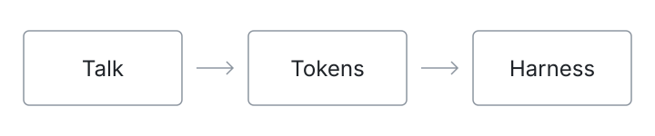

# Tether

**A local tether to cloud intelligence.**

The source code for **Tokens**: open-source dictation for Mac. Talk, and Tokens turns your speech into text on your Mac, then pastes it into Claude Code, Codex, or whatever app you're using.

Press **Right Option** to talk, press it again to paste. Parakeet v3 is the default speech model; Apple speech is an option.

## Get started

[Download Tokens](https://keeptinkr.ing) · [Build it yourself](docs/BUILDING.md)

Building requires an Apple Silicon Mac, Xcode 26+ and CMake. First launch downloads the speech model (about 740 MB).

## More

[Privacy](docs/PRIVACY.md) · [Contributing](CONTRIBUTING.md) · [Security](SECURITY.md) · [Benchmarks](docs/BENCHMARKS.md)

Code is [MIT licensed](LICENSE). Models and dependencies keep their [own licenses](THIRD_PARTY_NOTICES.md).
